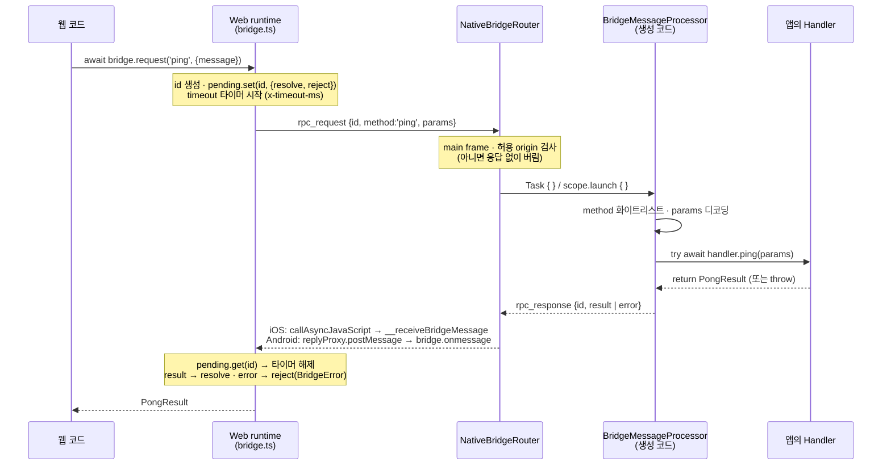

# bridgegen

**AsyncAPI 3.0 spec 하나로 WebView 브릿지의 Web · iOS · Android 패키지를 한 번에 만듭니다.**

```bash
npx bridgegen build asyncapi.yaml
```

| 산출물 | 형태 | 앱에서 쓰는 법 |
| --- | --- | --- |
| **JS** | npm 패키지 (`.tgz`, ESM + d.ts) | `npm install ./my-bridge-1.0.0.tgz` 또는 사내 registry에 `npm publish` |
| **iOS** | Swift Package (`Package.swift`) | Xcode *Add Package Dependencies* (로컬 경로 · git URL) |
| **Android** | Maven 아티팩트 (AAR + POM + sources) | `implementation("com.acme:my-bridge:1.0.0")` |
| **문서** | 단일 HTML (Swagger형 operation 목록) | 정적 호스팅 |

WebView ↔ Native 브릿지는 보통 웹 코드, iOS 코드, Android 코드, 위키에 따로 정의되어 있어 서로 어긋나도 배포한 뒤에야 알게 됩니다. bridgegen은 계약을 **yaml 하나**로 모으고, 어긋나면 **컴파일 단계**에서 깨지게 합니다.

- **Web:** 계약에 없는 이름 · 잘못된 params → TypeScript 컴파일 에러
- **iOS · Android:** operation이 추가됐는데 구현하지 않음 → 앱 빌드 실패 (`BridgeMethodHandling` 프로토콜 · 인터페이스)
- **세 플랫폼 런타임:** 같은 fixture로 conformance 테스트 (`test/fixtures`)

## PoC — 실제로 동작하는가

`bash poc/run.sh` 한 번으로 아래를 전부 합니다 (MacBook 기준 약 1분):

1. `examples/ping/asyncapi.yaml` → npm tgz · Swift Package · 로컬 Maven 저장소(AAR) 생성
2. React 테스트 앱(`poc/web`, Vite)이 **npm 패키지를 설치** · 빌드하고 `:8787`로 서빙
3. iOS 앱이 **Swift Package를**, Android 앱이 **Maven 아티팩트를** 받아 빌드 → 시뮬레이터 · 에뮬레이터에서 실행
4. 각 앱의 WebView가 REQUEST · SEND · RECEIVE를 실제로 주고받고 결과를 `poc/out/REPORT.md`에 기록

| iOS 시뮬레이터 (Swift Package) | Android 에뮬레이터 (Maven AAR) |
| --- | --- |
|  |  |

`bash poc/drift.sh`는 계약에 `getPingCount`를 추가한 v1.1.0으로 패키지를 다시 만들고, 구현을 추가하지 않은 두 앱이 **컴파일에 실패하는지** 확인합니다.

```
✓ iOS: 컴파일 실패 — type 'PocHandler' does not conform to protocol 'BridgeMethodHandling'
    note: protocol requires function 'getPingCount()' with type '() async throws -> PingCount'
✓ Android: 컴파일 실패 — Class 'PocHandler' is not abstract and does not implement abstract member: suspend fun getPingCount(): PingCount
```

## 통신 모델

모든 메시지는 JSON-RPC에서 개념을 가져온 envelope 세 가지 중 하나입니다. spec은 **WebView(웹) 관점**으로 씁니다.

| 배지 | AsyncAPI | envelope | 웹 | Native |
| --- | --- | --- | --- | --- |
| **REQUEST** | `action: send` + `reply` | `rpc_request` → `rpc_response` (같은 `id`) | `await bridge.request('ping', { message })` | `func ping(_:) -> PongResult` 에서 return |
| **SEND** | `action: send` | `event` (source web) | `bridge.emit('logPing', { message })` | `func logPing(_:)` — 일만 하고 응답 없음 |
| **RECEIVE** | `action: receive` | `event` (source native) | `bridge.on('nativePing', cb)` | `router.send(.nativePing(...))` — Native가 먼저 보냄 |

- **응답이 필요하면 REQUEST를 씁니다.** 값이 없어도 끝났는지 · 실패했는지 알아야 하면 REQUEST(빈 result)입니다. SEND를 보내고 RECEIVE로 결과를 받는 짝은 요청 id가 없어 동시 호출을 구분할 수 없으므로 만들지 않습니다.
- **Native → Web 진입점은 `window.__receiveBridgeMessage` 하나**입니다. 기능별 전역 콜백을 만들지 않습니다. 응답과 이벤트는 envelope의 `type`과 `id`로 구분합니다.
- **보안:** iOS는 메시지마다 `frameInfo`(main frame · https · 허용 host)를 검사합니다. Android는 `addJavascriptInterface` 대신 `addWebMessageListener`의 `allowedOriginRules`를 씁니다. 허용되지 않은 origin과 iframe은 응답 없이 버립니다.
- **지원 범위:** Router가 문서 시작 시 `window.__bridgeCapabilities`를 주입합니다. 웹은 앱이 모르는 operation을 보내지 않고 바로 `UNSUPPORTED_VERSION`으로 실패합니다.
- **준비 신호:** 웹 런타임이 수신 함수를 설치하면 `bridge.hello`를 보냅니다. Router는 그 전에 보낸 RECEIVE 이벤트를 쌓아 두었다가 이때 보냅니다. WKWebView의 `didFinish` 시점에도 페이지의 모듈 스크립트가 아직 실행 전일 수 있기 때문입니다.
- **오류:** 모든 실패는 `BridgeError { code, message, retryable, details }`로 정규화됩니다. code는 `UNAVAILABLE` · `SEND_FAILED` · `TIMEOUT` · `NATIVE_ERROR` · `INVALID_RESPONSE` · `UNSUPPORTED_VERSION` · `ABORTED`입니다.

## 동작 원리 — `request` 한 번이 오가는 길

`bridge.request()`는 **Promise**, Native Handler는 **Swift `async throws` / Kotlin `suspend`** 입니다. 그 사이를 envelope의 `id` 하나로 잇습니다.



### 1. Web — Promise를 만들고 `id`로 기다린다 (`runtime/web/bridge.ts`)

```ts
// createBridge() 안 (요약)
const pending = new Map<string, { resolve, reject, cleanup }>()

// ① 응답 입구는 하나. createBridge()가 한 번만 구독한다.
adapter.subscribe((raw) => {
  const msg = parseIncoming(raw)                    // envelope 형식 검증 (틀리면 버리고 로그)
  if (msg.type === 'rpc_response') {
    const p = pending.get(msg.id)
    if (!p) return log('unmatched')                 // 이미 timeout · 취소된 요청의 늦은 응답 → 무시
    p.cleanup()                                     // 타이머 해제 · pending에서 삭제
    msg.error ? p.reject(BridgeError.fromWire(msg.error)) : p.resolve(msg.result ?? {})
  } else {
    listeners.get(msg.event)?.forEach((l) => l(msg.payload))   // RECEIVE → bridge.on 구독자
  }
})

// ② request = Promise 하나 + pending 등록 + 전송
request(name, params, opts) {
  if (!adapter)              return Promise.reject(UNAVAILABLE)          // 웹뷰가 아님
  if (!isSupported(name))    return Promise.reject(UNSUPPORTED_VERSION)  // 앱이 모르는 method → 보내지 않음
  return new Promise((resolve, reject) => {
    const id = generateId()
    const timer = setTimeout(() => { cleanup(); reject(TIMEOUT) }, timeoutMs)
    opts.signal?.addEventListener('abort', () => { cleanup(); reject(ABORTED) })
    pending.set(id, { resolve, reject, cleanup })
    try { adapter.post({ type: 'rpc_request', id, version: 1, target: 'native', method: name, params }) }
    catch (e) { cleanup(); reject(SEND_FAILED) }
  })
}
```

- **동시 호출:** `ping`을 여러 번 동시에 보내도 응답마다 `id`가 달라 각자의 Promise로 갑니다. 응답 순서가 바뀌어도 괜찮습니다.
- **Promise는 정확히 한 번 끝난다:** resolve · reject · timeout · abort 중 먼저 온 것이 `cleanup()`으로 `pending`에서 지웁니다. 늦게 온 응답은 `unmatched` 로그만 남습니다.
- **플랫폼 차이는 adapter만 안다** (`runtime/web/adapter.ts`):

  | | 보내기 (Web → Native) | 받기 (Native → Web) |
  | --- | --- | --- |
  | iOS | `webkit.messageHandlers.bridge.postMessage(envelope)` | Native가 `window.__receiveBridgeMessage(json)` 호출 |
  | Android | `window.bridge.postMessage(JSON 문자열)` (`addWebMessageListener`가 주입한 객체) | `window.bridge.onmessage` |

### 2. Native Router — 받아서 비동기로 처리하고 같은 `id`로 답한다

**iOS** (`runtime/ios/NativeBridgeRouter.swift`)
```swift
func userContentController(_: WKUserContentController, didReceive message: WKScriptMessage) {
    guard message.frameInfo.isMainFrame, policy.allows(origin) else { return }   // iframe · 다른 origin → 버림
    Task { @MainActor in
        if let response = await BridgeMessageProcessor.handle(messageBody: body, handler: handler, onLog: onLog) {
            deliver(response)
        }
    }
}
private func deliver(_ envelope: Data) {
    // 문자열을 JS에 이어 붙이지 않고 arguments로 넘긴다 → 주입 불가
    webView.callAsyncJavaScript("window.__receiveBridgeMessage && window.__receiveBridgeMessage(m)",
                                arguments: ["m": String(decoding: envelope, as: UTF8.self)], in: nil, in: .page)
}
```

**Android** (`runtime/android/NativeBridgeRouter.kt`)
```kotlin
WebViewCompat.addWebMessageListener(webView, "bridge", allowedOriginRules) { _, message, _, isMainFrame, replyProxy ->
    if (!isMainFrame) return@addWebMessageListener                 // origin은 allowedOriginRules가 이미 걸렀다
    scope.launch {                                                  // lifecycleScope → 화면이 사라지면 함께 취소
        val response = BridgeMessageProcessor.handle(data, handler, onLog) ?: return@launch
        replyProxy.postMessage(response)                            // 요청을 보낸 그 frame으로 응답
    }
}
```

### 3. 생성 코드 — method 이름으로 Handler를 고르고 오류를 정규화한다

`BridgeMessageProcessor`는 계약에서 생성됩니다 (`BridgeContract.swift` / `BridgeContract.kt`). operation마다 한 줄씩 나옵니다.

```swift
// 먼저 method 문자열을 계약의 enum으로 바꾼다. 없으면 → METHOD_NOT_ALLOWED
guard let m = BridgeMethod(rawValue: method) else {
    return fail(.nativeError, "화이트리스트에 없는 method", details: .methodNotAllowed)
}
do {
    switch m {                       // enum이라 operation이 추가되면 여기 · Handler 둘 다 컴파일 에러
    case .ping:
        return reply(try await handler.ping(try BridgeCoding.decode(PingParams.self, obj["params"])))
    case .resetPing:
        try await handler.resetPing()
        return reply(EmptyPayload())
    }
} catch let failure as BridgeFailure {      // Handler가 계약의 오류 코드로 throw
    return fail(.nativeError, failure.message, details: failure.code, retryable: failure.retryable)
} catch is DecodingError {                  // params가 계약과 다름
    return fail(.nativeError, "params가 계약과 다름", details: .invalidParams)
} catch {                                   // 그 밖의 예외
    return fail(.nativeError, String(describing: error), details: .internal)
}
```

Kotlin도 같은 구조입니다 (`BridgeMethod.fromWire(method)` → `when (m) { BridgeMethod.PING -> reply(..., handler.ping(decode(...))) }`).

Handler가 던진 것은 모두 `rpc_response.error`로 바뀌어 웹의 Promise를 reject합니다.

| Native에서 일어난 일 | 웹이 받는 `BridgeError` |
| --- | --- |
| `return value` | resolve(`value`) — 반환 타입이 없으면 `{}` (완료 확인) |
| `throw BridgeFailure(.pingRejected, "…")` | `NATIVE_ERROR`, `details.code = 'PING_REJECTED'` (계약의 `x-native-errors`) |
| params가 계약과 다름 (디코딩 실패) | `NATIVE_ERROR`, `details.code = 'INVALID_PARAMS'` |
| 계약에 없는 method | `NATIVE_ERROR`, `details.code = 'METHOD_NOT_ALLOWED'` |
| 그 밖의 예외 | `NATIVE_ERROR`, `details.code = 'INTERNAL'` |
| envelope `version`이 다름 | `UNSUPPORTED_VERSION` |
| 응답이 `x-timeout-ms` 안에 오지 않음 | `TIMEOUT` (웹 타이머) |

Handler가 오래 걸리는 일(API 호출, 권한 팝업)을 `await`해도 됩니다. 그동안 웹의 Promise는 pending 상태이며, timeout 안에 return하면 resolve됩니다. 사용자 입력처럼 오래 걸리는 operation은 계약에서 `x-timeout-ms`를 넉넉히 둡니다.

### 4. RECEIVE는 왜 다르게 동작하나

RECEIVE(Native가 먼저 보내는 event)에는 기다리는 Promise가 없으므로 `id`가 없습니다. `router.send(.nativePing(...))`는 envelope를 만들어 같은 입구(`__receiveBridgeMessage` / `onmessage`)로 보내고, Web runtime이 `bridge.on` 구독자에게 나눠 줍니다.

- **웹 준비 전에 보낸 이벤트:** 웹 runtime이 수신 함수를 설치한 뒤 `bridge.hello`를 보낼 때까지 Router가 최대 32개를 쌓아 두었다가 hello를 받으면 보냅니다.
- **페이지 이동:** iOS는 새 문서의 document-start 스크립트가 `bridge.documentStart`를 보내면 준비 상태를 끄고, 새 hello가 오면 다시 켭니다. Android는 hello를 보낸 문서의 `replyProxy`로 이벤트를 보내고, 새 문서가 hello를 보내면 그 proxy로 바꿉니다. **알려진 한계:** Android에서는 이동 직후부터 새 hello가 오기 전까지 보낸 이벤트가 이전 문서의 proxy로 가서 사라질 수 있습니다.

## spec 작성

`bridgegen init`이 예시(`examples/ping/asyncapi.yaml`)를 복사해 줍니다.

```yaml
info:
  title: Acme Bridge
  version: 1.0.0
  x-bridgegen:
    npm: { name: '@acme/bridge' }
    android: { groupId: com.acme, artifactId: bridge, package: com.acme.bridge }
    swift: { module: AcmeBridge }
    reservedNames: [showToast, requestClose]   # 이전 세대 브릿지 이름과 겹치지 않게

operations:
  ping:                      # 이름: 점 없는 lowerCamelCase, 'bridge'로 시작하면 안 됨 (런타임 예약)
    action: send
    x-kind: request          # request | emit | event
    x-since: { ios: 3.3.0, android: 3.3.0 }
    x-idempotent: true       # TIMEOUT · SEND_FAILED에서 자동 재시도해도 되는 읽기 요청
    x-timeout-ms: 3000
    x-native-errors: [PING_REJECTED]
    ...
```

지원하는 JSON Schema 범위는 일부러 좁습니다. object(필드는 `$ref` · string · integer · number · boolean · array · string enum)와 string enum만 지원합니다. 범위를 넘으면 `any`로 두지 않고 에러를 냅니다.

## 앱에서 쓰기

### Web

```ts
import { createBridge, isBridgeError } from '@acme/bridge'
const bridge = createBridge()
const pong = await bridge.request('ping', { message: 'hello' })   // PongResult
bridge.emit('logPing', { message: 'hi' })
const off = bridge.on('nativePing', ({ message }) => {})
```

세 가지 호출의 차이:

| 호출 | 반환 | 언제 끝나나 | 리스너 · useEffect |
| --- | --- | --- | --- |
| `bridge.request(name, params)` | `Promise<Result>` | Native가 같은 `id`로 응답하면 resolve, 오류 · timeout이면 reject | 필요 없음 — `fetch`처럼 `await` |
| `bridge.emit(name, payload)` | `boolean` (보냈는지) | 보내는 즉시 | 필요 없음 |
| `bridge.on(name, cb)` | 해제 함수 `() => void` | 해제할 때까지 Native가 보낼 때마다 `cb` | **구독 · 해제가 필요** (React면 `useEffect`) |

`createBridge()`가 Native 응답 입구(iOS `window.__receiveBridgeMessage`, Android `bridge.onmessage`)에 리스너를 **한 번** 걸고, 들어온 메시지를 `rpc_response`면 `id`로 짝을 찾아 해당 Promise에, `event`면 `bridge.on` 구독자에게 나눠 줍니다. 그래서 앱 코드에서 `window.addEventListener`나 전역 콜백(`window.onXxx = ...`)을 만들 일이 없습니다.

#### React에서 쓰기

**1. bridge는 앱에 하나만 — 모듈에서 만든다**

컴포넌트 안(렌더 · `useEffect`)에서 `createBridge()`를 부르지 않습니다. StrictMode에서 두 번 만들어지고, 마운트 전에 Native가 보낸 이벤트를 놓칠 수 있습니다.

```ts
// src/shared/bridge.ts
import { createBridge } from '@acme/bridge'

export const bridge = createBridge()
// 일반 브라우저(웹뷰 아님)에서도 import는 안전하다: bridge.available === false, request는 UNAVAILABLE로 reject
```

**2. REQUEST — 이벤트 핸들러에서 `await`**

```tsx
import { isBridgeError } from '@acme/bridge'
import { bridge } from '@/shared/bridge'

function PingButton() {
  const [reply, setReply] = useState<string>()
  const [pending, setPending] = useState(false)

  const onClick = async () => {
    setPending(true)
    try {
      const pong = await bridge.request('ping', { message: 'hello' })  // pong: PongResult (타입 자동)
      setReply(pong.reply)                                              // ← 응답이 오면 여기서 처리
    } catch (e) {
      if (!isBridgeError(e)) throw e
      if (e.code === 'NATIVE_ERROR' && e.details?.code === 'PING_REJECTED') setReply('거절됨')
      else setReply(`실패: ${e.code}`)   // TIMEOUT · UNSUPPORTED_VERSION · UNAVAILABLE ...
    } finally {
      setPending(false)
    }
  }

  return <button disabled={pending} onClick={onClick}>{reply ?? 'ping'}</button>
}
```

**3. REQUEST — 화면이 뜰 때 한 번 받아 와야 하면 `useEffect` + 취소**

구독이 아니라 `fetch`와 같은 1회 호출입니다. 응답 전에 화면을 떠나면 `AbortController`로 끊습니다 (`ABORTED`로 reject).

```tsx
useEffect(() => {
  const ac = new AbortController()
  bridge
    .request('ping', { message: 'init' }, { signal: ac.signal, timeoutMs: 1000 })
    .then((pong) => setReply(pong.reply))
    .catch((e) => {
      if (isBridgeError(e) && e.code === 'ABORTED') return
      setReply('앱에서 응답 없음')
    })
  return () => ac.abort()
}, [])
```

데이터 페칭 라이브러리를 쓰면 `queryFn`에 그대로 넘기면 됩니다. Promise를 돌려주는 일반 API와 같습니다.

```tsx
const { data } = useQuery({
  queryKey: ['bridge', 'ping'],
  queryFn: ({ signal }) => bridge.request('ping', { message: 'hello' }, { signal }),
  enabled: bridge.isSupported('ping'),   // 구버전 앱 · 일반 브라우저에서는 호출하지 않음
})
```

**4. SEND — 보내고 끝**

```tsx
<button onClick={() => bridge.emit('logPing', { message: 'clicked' })}>log</button>
```

결과가 필요하면 SEND가 아니라 REQUEST로 정의합니다 (계약 규칙). `emit`이 `false`를 돌려주면 브릿지가 없거나 앱이 지원하지 않아 보내지 않은 것입니다.

**5. RECEIVE — `useEffect`로 구독하고 해제**

Native가 언제 보낼지 모르므로 화면이 떠 있는 동안만 듣습니다. `bridge.on`이 돌려주는 해제 함수를 cleanup으로 그대로 반환합니다.

```tsx
function NativePingList() {
  const [messages, setMessages] = useState<string[]>([])

  useEffect(() => {
    return bridge.on('nativePing', (p) => {   // p: NativePingPayload (타입 자동)
      setMessages((m) => [...m, p.message])
    })
  }, [])

  return <ul>{messages.map((m, i) => <li key={i}>{m}</li>)}</ul>
}
```

여러 곳에서 쓰면 훅으로 묶습니다. 콜백을 ref에 두면 렌더마다 재구독하지 않습니다.

```ts
import { useEffect, useRef } from 'react'
import type { BridgeEvents } from '@acme/bridge'
import { bridge } from '@/shared/bridge'

export function useBridgeEvent<N extends keyof BridgeEvents>(name: N, handler: (payload: BridgeEvents[N]) => void) {
  const ref = useRef(handler)
  ref.current = handler
  useEffect(() => bridge.on(name, (p) => ref.current(p)), [name])
}

// 사용
useBridgeEvent('nativePingStopped', () => setRunning(false))
```

> Native는 웹이 준비(`bridge.hello`)되기 전에 보낸 이벤트를 쌓아 두었다가 보내 주지만, **그 시점에 구독자가 없으면 버려집니다.** 앱 시작 직후 오는 이벤트를 놓치면 안 된다면 1번의 모듈(`shared/bridge.ts`)에서 바로 구독해 store(zustand · Redux · `useSyncExternalStore`)에 넣고, 컴포넌트는 store를 읽습니다. `poc/web/src/bridge.ts`가 이 방식입니다.

**6. 지원 여부로 UI 분기**

```tsx
{bridge.isSupported('ping') ? <PingButton /> : <p>앱을 업데이트해 주세요</p>}
```

`isSupported`는 앱이 문서 시작 시 주입한 `window.__bridgeCapabilities`를 봅니다. 웹이 먼저 배포되고 앱은 구버전인 경우를 여기서 걸러 냅니다.

**7. 타입이 막아 주는 것**

```ts
bridge.request('pingg', { message: 'x' })   // ✗ 계약에 없는 이름
bridge.request('ping', { msg: 'x' })        // ✗ params 필드가 다름
const pong = await bridge.request('ping', { message: 'x' })
pong.foo                                    // ✗ PongResult에 없는 필드
bridge.on('nativePing', (p) => p.count)     // ✗ NativePingPayload에 없는 필드
```

전체 예시: [`poc/web`](poc/web) (React + Vite) — 버튼으로 REQUEST · SEND를 보내고, 앱 하단 네이티브 버튼으로 RECEIVE를 받으며, 주고받은 envelope 원문을 로그로 보여 줍니다.

### iOS · Android

**iOS**
```swift
import AcmeBridge
@MainActor final class Handler: BridgeMethodHandling {
    func ping(_ p: PingParams) async throws -> PongResult { PongResult(reply: "pong: \(p.message)", platform: .ios) }
    func resetPing() async throws {}
    func logPing(_ p: PingParams) async throws {}
    func clearPingLog() async throws {}
}
let router = NativeBridgeRouter(handler: Handler(), policy: .init(allowedHosts: ["acme.com"]))
router.attach(to: webView, appVersion: "3.3.0")
router.send(.nativePing(.init(message: "hello", platform: .ios)))
```

**Android**
```kotlin
class Handler : BridgeMethodHandling {
    override suspend fun ping(params: PingParams) = PongResult("pong: ${params.message}", Platform.ANDROID)
    override suspend fun resetPing() {}
    override suspend fun logPing(params: PingParams) {}
    override suspend fun clearPingLog() {}
}
val router = NativeBridgeRouter(Handler(), lifecycleScope, setOf("https://acme.com"), BuildConfig.VERSION_NAME)
router.attach(webView)
router.send(BridgeEvent.NativePing(NativePingPayload("hello", Platform.ANDROID)))
```

## CLI

```
bridgegen build <spec.yaml> [--out <dir>] [--targets js,ios,android,docs]
                [--no-pack] [--no-android-publish] [--verify-ios]
bridgegen validate <spec.yaml>
bridgegen compat <base-spec.yaml> <head-spec.yaml>   # 깨지는 변경 검사 (웹과 앱이 따로 배포되는 걸 전제로)
bridgegen init [dir]
```

`build`가 필요로 하는 것:
- **js:** Node 20+
- **ios:** 소스 생성만이면 없음. `--verify-ios`는 Xcode 필요
- **android:** Android SDK + JDK 17. 없으면 `--no-android-publish`로 Gradle 프로젝트 소스만 만듭니다

Android 라이브러리는 AGP 8.10.1 · Kotlin 2.1.20 · kotlinx-serialization 1.6.3 · coroutines 1.7.3 · androidx.webkit 1.14.0 · compileSdk 35 · minSdk 24(설정 가능)로 빌드합니다. 생성된 `android/build.gradle.kts`의 `publishing.repositories`에 사내 Maven 저장소를 추가하면 그대로 배포됩니다.

## 개발

```bash
npm install
npm test                 # 웹 런타임 · fixture · 설정 테스트 + 타입 검사
bash test/ios/run.sh     # Swift conformance (macOS)
eval "$(bash test/android/fetch-kotlin-toolchain.sh .toolchain)" && bash test/android/run.sh   # Kotlin conformance
bash poc/run.sh          # 시뮬레이터 · 에뮬레이터 end-to-end
bash poc/drift.sh        # 계약 변경 → 컴파일 오류 증명
```

## 라이선스

MIT
