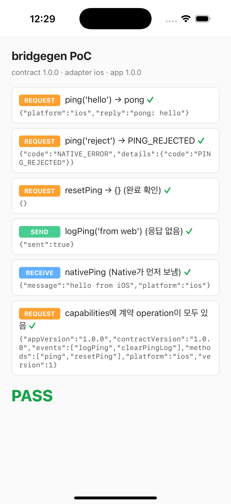
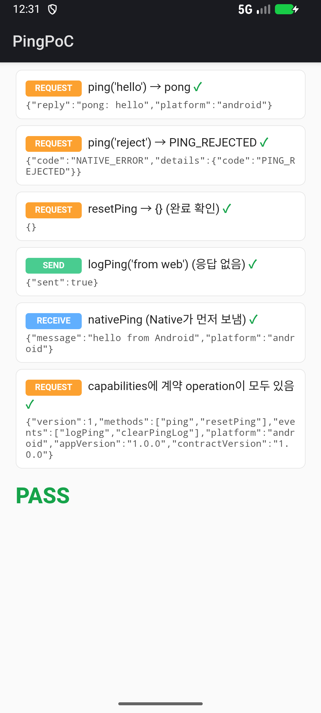

# bridgegen

**AsyncAPI 3.0 spec 하나로 WebView 브릿지의 Web · iOS · Android 패키지를 한 번에 만듭니다.**

```bash
npx bridgegen build asyncapi.yaml
```

| 산출물 | 형태 | 앱에서 쓰는 법 |
| --- | --- | --- |
| **JS** | npm 패키지 (`.tgz`, ESM + d.ts) | `npm install ./my-bridge-1.0.0.tgz` 또는 사내 registry에 `npm publish` |
| **iOS** | Swift Package (`Package.swift`) | Xcode *Add Package Dependencies* (로컬 경로 · git URL) |
| **Android** | Maven 아티팩트 (AAR + POM + sources) | `implementation("com.acme:my-bridge:1.0.0")` |
| **문서** | 단일 HTML (Swagger형 operation 목록) | 정적 호스팅 |

WebView ↔ Native 브릿지는 보통 웹 코드, iOS 코드, Android 코드, 위키에 따로 정의되어 있어 서로 어긋나도 배포한 뒤에야 알게 됩니다. bridgegen은 계약을 **yaml 하나**로 모으고, 어긋나면 **컴파일 단계**에서 깨지게 합니다.

- **Web:** 계약에 없는 이름 · 잘못된 params → TypeScript 컴파일 에러
- **iOS · Android:** operation이 추가됐는데 구현하지 않음 → 앱 빌드 실패 (`BridgeMethodHandling` 프로토콜 · 인터페이스)
- **세 플랫폼 런타임:** 같은 fixture로 conformance 테스트 (`test/fixtures`)

## PoC — 실제로 동작하는가

`bash poc/run.sh` 한 번으로 아래를 전부 합니다 (MacBook 기준 약 1분):

1. `examples/ping/asyncapi.yaml` → npm tgz · Swift Package · 로컬 Maven 저장소(AAR) 생성
2. 테스트 웹 페이지가 **npm 패키지를 설치**하고 `:8787`로 서빙
3. iOS 앱이 **Swift Package를**, Android 앱이 **Maven 아티팩트를** 받아 빌드 → 시뮬레이터 · 에뮬레이터에서 실행
4. 각 앱의 WebView가 REQUEST · SEND · RECEIVE를 실제로 주고받고 결과를 `poc/out/REPORT.md`에 기록

| iOS 시뮬레이터 (Swift Package) | Android 에뮬레이터 (Maven AAR) |
| --- | --- |
|  |  |

`bash poc/drift.sh`는 계약에 `getPingCount`를 추가한 v1.1.0으로 패키지를 다시 만들고, 구현을 추가하지 않은 두 앱이 **컴파일에 실패하는지** 확인합니다.

```
✓ iOS: 컴파일 실패 — type 'PocHandler' does not conform to protocol 'BridgeMethodHandling'
    note: protocol requires function 'getPingCount()' with type '() async throws -> PingCount'
✓ Android: 컴파일 실패 — Class 'PocHandler' is not abstract and does not implement abstract member: suspend fun getPingCount(): PingCount
```

## 통신 모델

모든 메시지는 JSON-RPC에서 개념을 가져온 envelope 세 가지 중 하나입니다. spec은 **WebView(웹) 관점**으로 씁니다.

| 배지 | AsyncAPI | envelope | 웹 | Native |
| --- | --- | --- | --- | --- |
| **REQUEST** | `action: send` + `reply` | `rpc_request` → `rpc_response` (같은 `id`) | `await bridge.request('ping', { message })` | `func ping(_:) -> PongResult` 에서 return |
| **SEND** | `action: send` | `event` (source web) | `bridge.emit('logPing', { message })` | `func logPing(_:)` — 일만 하고 응답 없음 |
| **RECEIVE** | `action: receive` | `event` (source native) | `bridge.on('nativePing', cb)` | `router.send(.nativePing(...))` — Native가 먼저 보냄 |

- **응답이 필요하면 REQUEST를 씁니다.** 값이 없어도 끝났는지 · 실패했는지 알아야 하면 REQUEST(빈 result)입니다. SEND를 보내고 RECEIVE로 결과를 받는 짝은 요청 id가 없어 동시 호출을 구분할 수 없으므로 만들지 않습니다.
- **Native → Web 진입점은 `window.__receiveBridgeMessage` 하나**입니다. 기능별 전역 콜백을 만들지 않습니다. 응답과 이벤트는 envelope의 `type`과 `id`로 구분합니다.
- **보안:** iOS는 메시지마다 `frameInfo`(main frame · https · 허용 host)를 검사합니다. Android는 `addJavascriptInterface` 대신 `addWebMessageListener`의 `allowedOriginRules`를 씁니다. 허용되지 않은 origin과 iframe은 응답 없이 버립니다.
- **지원 범위:** Router가 문서 시작 시 `window.__bridgeCapabilities`를 주입합니다. 웹은 앱이 모르는 operation을 보내지 않고 바로 `UNSUPPORTED_VERSION`으로 실패합니다.
- **준비 신호:** 웹 런타임이 수신 함수를 설치하면 `bridge.hello`를 보냅니다. Router는 그 전에 보낸 RECEIVE 이벤트를 쌓아 두었다가 이때 보냅니다. WKWebView의 `didFinish` 시점에도 페이지의 모듈 스크립트가 아직 실행 전일 수 있기 때문입니다.
- **오류:** 모든 실패는 `BridgeError { code, message, retryable, details }`로 정규화됩니다. code는 `UNAVAILABLE` · `SEND_FAILED` · `TIMEOUT` · `NATIVE_ERROR` · `INVALID_RESPONSE` · `UNSUPPORTED_VERSION` · `ABORTED`입니다.

## spec 작성

`bridgegen init`이 예시(`examples/ping/asyncapi.yaml`)를 복사해 줍니다.

```yaml
info:
  title: Acme Bridge
  version: 1.0.0
  x-bridgegen:
    npm: { name: '@acme/bridge' }
    android: { groupId: com.acme, artifactId: bridge, package: com.acme.bridge }
    swift: { module: AcmeBridge }
    reservedNames: [showToast, requestClose]   # 이전 세대 브릿지 이름과 겹치지 않게

operations:
  ping:                      # 이름: 점 없는 lowerCamelCase, 'bridge'로 시작하면 안 됨 (런타임 예약)
    action: send
    x-kind: request          # request | emit | event
    x-since: { ios: 3.3.0, android: 3.3.0 }
    x-idempotent: true       # TIMEOUT · SEND_FAILED에서 자동 재시도해도 되는 읽기 요청
    x-timeout-ms: 3000
    x-native-errors: [PING_REJECTED]
    ...
```

지원하는 JSON Schema 범위는 일부러 좁습니다. object(필드는 `$ref` · string · integer · number · boolean · array · string enum)와 string enum만 지원합니다. 범위를 넘으면 `any`로 두지 않고 에러를 냅니다.

## 앱에서 쓰기

**Web**
```ts
import { createBridge, isBridgeError } from '@acme/bridge'
const bridge = createBridge()
const pong = await bridge.request('ping', { message: 'hello' })   // PongResult
bridge.emit('logPing', { message: 'hi' })
const off = bridge.on('nativePing', ({ message }) => {})
```

**iOS**
```swift
import AcmeBridge
@MainActor final class Handler: BridgeMethodHandling {
    func ping(_ p: PingParams) async throws -> PongResult { PongResult(reply: "pong: \(p.message)", platform: .ios) }
    func resetPing() async throws {}
    func logPing(_ p: PingParams) async throws {}
    func clearPingLog() async throws {}
}
let router = NativeBridgeRouter(handler: Handler(), policy: .init(allowedHosts: ["acme.com"]))
router.attach(to: webView, appVersion: "3.3.0")
router.send(.nativePing(.init(message: "hello", platform: .ios)))
```

**Android**
```kotlin
class Handler : BridgeMethodHandling {
    override suspend fun ping(params: PingParams) = PongResult("pong: ${params.message}", Platform.ANDROID)
    override suspend fun resetPing() {}
    override suspend fun logPing(params: PingParams) {}
    override suspend fun clearPingLog() {}
}
val router = NativeBridgeRouter(Handler(), lifecycleScope, setOf("https://acme.com"), BuildConfig.VERSION_NAME)
router.attach(webView)
router.send(BridgeEvent.NativePing(NativePingPayload("hello", Platform.ANDROID)))
```

## CLI

```
bridgegen build <spec.yaml> [--out <dir>] [--targets js,ios,android,docs]
                [--no-pack] [--no-android-publish] [--verify-ios]
bridgegen validate <spec.yaml>
bridgegen compat <base-spec.yaml> <head-spec.yaml>   # 깨지는 변경 검사 (웹과 앱이 따로 배포되는 걸 전제로)
bridgegen init [dir]
```

`build`가 필요로 하는 것:
- **js:** Node 20+
- **ios:** 소스 생성만이면 없음. `--verify-ios`는 Xcode 필요
- **android:** Android SDK + JDK 17. 없으면 `--no-android-publish`로 Gradle 프로젝트 소스만 만듭니다

Android 라이브러리는 AGP 8.10.1 · Kotlin 2.1.20 · kotlinx-serialization 1.6.3 · coroutines 1.7.3 · androidx.webkit 1.14.0 · compileSdk 35 · minSdk 24(설정 가능)로 빌드합니다. 생성된 `android/build.gradle.kts`의 `publishing.repositories`에 사내 Maven 저장소를 추가하면 그대로 배포됩니다.

## 개발

```bash
npm install
npm test                 # 웹 런타임 · fixture · 설정 테스트 + 타입 검사
bash test/ios/run.sh     # Swift conformance (macOS)
eval "$(bash test/android/fetch-kotlin-toolchain.sh .toolchain)" && bash test/android/run.sh   # Kotlin conformance
bash poc/run.sh          # 시뮬레이터 · 에뮬레이터 end-to-end
bash poc/drift.sh        # 계약 변경 → 컴파일 오류 증명
```

## 라이선스

MIT
